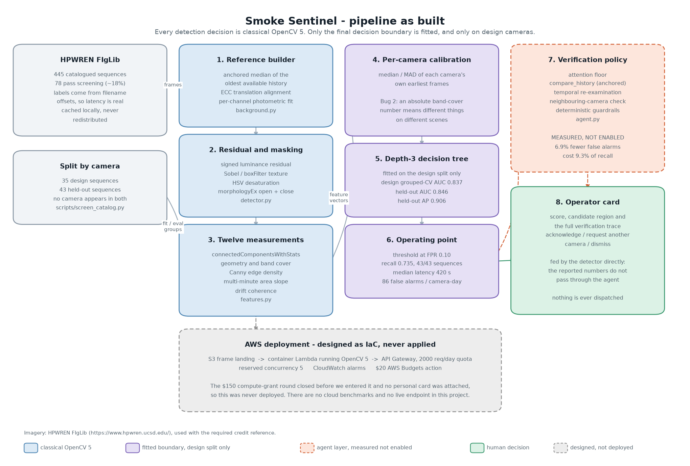
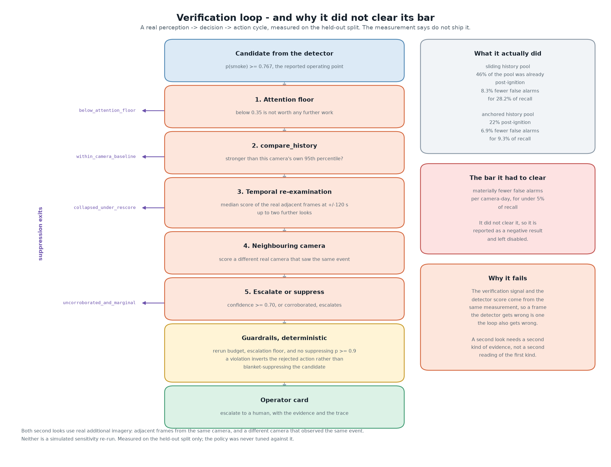

# Smoke Sentinel: technical report

**OpenCV AI Competition 2026**
Nelson Lai, City College of San Francisco
Repository: <https://github.com/chinesepowered/hack-opencv1>

Camera imagery: **HPWREN FIgLib**, credit reference <https://www.hpwren.ucsd.edu/> as their terms
require. No original FIgLib frame is redistributed in this repository; the figures below and the
demo pack in `web/pack/` are derived, annotated renderings, which their terms permit with that
credit. See [`DATA.md`](DATA.md).

---

## 1. Summary

Smoke Sentinel detects early wildfire smoke on fixed fire-watch cameras using classical OpenCV 5
temporal change detection, with a small interpretable decision boundary fitted on top.

On **43 cameras never seen during design**, it reaches **AUC 0.846** and **average precision 0.906**,
against **0.440** for the naive luminance-residual baseline. Per sequence the median AUC is **0.937**.

It is **not deployable at its operating point**, and this report says so as plainly as it says the
AUC. At the sensitivity where all 43 held-out sequences are caught, it raises about **86 false
alarms per camera-day**. A fire-watch desk needs well under one. That gap is the central result.

An agentic verification layer was built specifically to close that gap. It was measured, it did not
clear its bar, and it is **reported here as a negative result and left disabled**. Section 7 gives
the numbers and the diagnosis.

Nothing in this project was deployed to AWS. Section 10 explains exactly why, and no cloud number
appears anywhere in this repository.



---

## 2. Why this is a change-detection problem, not an object-detection problem

A wildfire is cheapest to fight in its first twenty minutes. Fire-watch cameras already point at the
right ridgelines around the clock; the scarce resource is a human looking at the right one of
hundreds of feeds at the right moment.

Smoke in those first minutes is not an object with a boundary. It is a faint, low-contrast, slowly
spreading change in texture that looks a great deal like fog, dust, haze, and cloud shadow moving
across the same hillside. A bounding box drawn around it is a judgement call even for a person.

What it *is*, reliably, is a **change against a scene that otherwise does not change**. A fixed
camera gives that for free: the terrain is constant apart from illumination, weather, and the thing
we care about. So the primitive here is a long-baseline residual, not a detector head.

### The measurement that forced this design

The first version of this project compared frames **60 seconds apart**. Measured on real FIgLib
sequences, pre-ignition and post-ignition windows were statistically indistinguishable on every
short-baseline feature:

| Short-baseline feature | Pre-ignition | Post-ignition |
| --- | --- | --- |
| Texture drop | -0.005 | -0.003 |
| Saturation change | -0.002 | +0.002 |
| Motion cells (of 256) | 117 | 103 |

The physics says why. A plume takes 10 to 40 minutes to grow, so between two consecutive frames it
changes the image about as much as wind in the chaparral does. Sampled against a reference 15 to 45
minutes old, it is obvious. That single measurement rewrote the detector.

---

## 3. Data, labels and splits

**Source.** HPWREN Fire Ignition images Library (FIgLib), 445 catalogued sequences. Each sequence is
roughly 80 minutes of one camera at 60 s cadence, centred on an ignition.

**Labels come free with the filenames.** FIgLib names each frame
`<origin_timestamp>_<offset_seconds>.jpg`, where the offset is signed seconds from the moment a
human annotator marked the plume visible. Negative is before, non-negative is after. This gives both
binary labels and, because the offsets are real seconds, an **exact detection-latency measurement**
rather than a proxy.

> **Parsing trap worth recording.** FIgLib URL-encodes the leading `+` of non-negative offsets as
> `%2B`, for example `1500763593_%2B02280.jpg`. A naive `r"_(-?\d+)\.jpg$"` silently matches only
> the *pre-ignition* half of every sequence and throws away all the positive labels. The regex in
> `src/sentinel/data.py` handles the encoded form explicitly.

**Screening.** Of 445 sequences, **78 (~18%) carry usable classical-CV signal** under our screening
(`scripts/screen_catalog.py`). The rest are too diffuse, lack desaturation, or are night and dawn
exposures where this approach has no basis. Discarding 82% of the catalogue is a limitation, stated
in section 11, not a result to hide.

**Splits are by camera, not by frame.**

| Split | Sequences | Rows |
| --- | --- | --- |
| Design (fit and model selection) | 35 | 1,968 |
| Held out (reported numbers) | 43 | 2,261 |

No camera appears in both. Frames from one sequence are heavily correlated, so a random frame split
would have reported a number with no meaning. Four design sequences were additionally marked
`design_contaminated_by_inspection` because they were looked at while debugging; they stay in the
design split and are never scored.

**The held-out split was scored once per code change, and the verification policy of section 7 was
never tuned against it.** Section 7.5 records the point where that rule cost us a result.

---

## 4. Method

### 4.1 Reference building (`src/sentinel/background.py`)

A per-pixel **median** over a sparse set of older frames. Median rather than mean because a mean is
dragged by the very plume we are trying to find, and by birds, insects and lens flare; a median is
immune as long as the plume covers fewer than half the sampled frames.

The reference is **anchored to the oldest available history** rather than sliding forward with the
query frame. Section 6 explains why that one word is the difference between AUC 0.50 and 0.85.

Before differencing:

* **ECC translation alignment** (`cv2.findTransformECC`). Fixed cameras are not perfectly fixed, and
  a few pixels of mast sway turns every high-contrast edge into a false "change" that would swamp a
  diffuse plume. A failed convergence is skipped silently, because a failed alignment is better than
  a wrong one.
* **Per-channel photometric match**, a robust gain-and-offset fit on a subsample. Sun angle moves
  across the reference window and cameras auto-expose; this removes that without touching local
  structure, so the residual holds only what changed *in the scene*.

### 4.2 Residual and masking (`src/sentinel/detector.py`)

Signed luminance residual against the reference, thresholded inside a band that starts well above
the estimated horizon (plumes straddle the ridge), then `morphologyEx` open to drop speckle and
close to fill the gaps inside a diffuse plume.

**The polarity is not fixed.** A white plume over dark terrain raises luminance; a dense grey plume
against bright hazy sky lowers it. Measured on FIgLib both occur, so the mask uses absolute
deviation and the *sign is kept as a feature*.

Texture energy is a `Sobel` magnitude smoothed by `boxFilter`. Smoke is a scattering medium: it
erases the ridgeline behind it, so local gradient energy drops where it covers structure. Cloud
shadow shifts luminance and *keeps* texture, which is what makes the joint test specific.

### 4.3 Twelve measurements (`src/sentinel/features.py`)

`connectedComponentsWithStats` over the joint "changed luminance **and** lost texture" mask picks the
largest plausible region, and twelve numbers are measured on it:

`lum_signed`, `lum_dark_frac`, `tex_drop`, `desat`, `area_frac`, `compactness`, `aspect`,
`centroid_y_rel`, `band_cover`, `edge_density`, `area_slope_per_min`, `drift_coherence`.

Two of those are temporal and matter more than their names suggest:

* **`area_slope_per_min`**, the growth of the joint-mask area fitted over a multi-minute baseline.
  The 60-second "growth" measured in the first version ran *backwards* (Cohen's d = -0.89) because
  it was tracking cloud churn.
* **`drift_coherence`**, the resultant length of the residual centroid's direction changes. A plume
  drifts coherently over minutes; cloud churn reverses direction and sensor noise has no direction
  at all.

When no region deviates enough to measure, `extract` returns `None` rather than a row of zeros. An
honest non-answer does not pollute a fit; a fabricated zero does.

### 4.4 Per-camera calibration and the fitted boundary

Features are normalised by the **median and MAD of each camera's own earliest frames**. Section 6
explains why. This is what a deployed per-camera calibration would do anyway.

A **depth-3 decision tree** is fitted on the design split only, selected over logistic regression by
grouped cross-validation:

| Model | Design grouped-CV AUC | Design grouped-CV AP |
| --- | --- | --- |
| Logistic regression | 0.815 | 0.901 |
| **Depth-3 tree** | **0.837** | **0.906** |

Depth 3 is a deliberate ceiling. With 35 design cameras, anything deeper fits cameras rather than
smoke, and the whole tree stays small enough to read:

```
band_cover <= 1.63
|-- desat <= -1.41
|   |-- edge_density <= -0.72  -> smoke
|   |-- edge_density >  -0.72  -> clear
|-- desat >  -1.41
    |-- tex_drop <= -3.65      -> smoke
    |-- tex_drop >  -3.65      -> clear
band_cover >  1.63
|-- band_cover <= 4.57
|   |-- centroid_y_rel <= 5.67 -> smoke
|   |-- centroid_y_rel >  5.67 -> clear
|-- band_cover >  4.57         -> smoke
```

The pipeline is still an OpenCV pipeline. No learned representation appears anywhere; only the final
decision boundary is fitted, and the model never scores pixels.

---

## 5. Results

All numbers below are on the **43 held-out cameras**, 2,261 scored frames (1,576 post-ignition,
685 pre-ignition), from a model fitted on the 35 design cameras only.

| Metric | Value |
| --- | --- |
| **Held-out AUC** | **0.846** |
| Held-out average precision | 0.906 |
| Naive baseline (absolute luminance residual, no fit) | 0.440 |
| Design grouped-CV AUC | 0.837 |

The naive baseline sitting *below* chance is itself informative: the raw residual magnitude alone
genuinely does not separate smoke from weather, which is the whole argument for the joint texture
and desaturation test.

### Per-sequence

Of the 30 held-out sequences that contain both classes after screening:

| Per-sequence held-out AUC | Count |
| --- | --- |
| Median | 0.937 |
| At or above 0.90 | 19 of 30 |
| At or above 0.70 | 26 of 30 |
| Below 0.50 | 0 of 30 |

The four weakest are `om-s` (0.549), `starr-n` (0.569), `sjh-n` (0.650) and `sojr-s` (0.665). Nothing
falls below chance, so the failures are weak signal rather than inverted signal.

### Sensitivity sweep

Latency is measured in real seconds from the annotator's "plume visible" mark.

| Target FPR | Threshold | Recall | Sequences detected | Median latency | p90 latency | False alarms / camera-day |
| --- | --- | --- | --- | --- | --- | --- |
| 0.05 | 0.889 | 0.489 | 36 / 43 | 1110 s | 2038 s | 20.4 |
| **0.10** | **0.767** | **0.735** | **43 / 43** | **420 s** | 1668 s | **86.4** |
| 0.20 | 0.201 | 0.796 | 43 / 43 | 240 s | 1236 s | 163.2 |

False alarms per camera-day scale the pre-ignition alert count by the pre-ignition exposure of the
cameras that actually contributed scored frames: 30 sequences at roughly 40 pre-ignition minutes
each, so 20 camera-hours.

### What the operating point means

Read the middle row operationally rather than as a score. Seven minutes after a human annotator
could see the plume, on a camera the system has never seen, it fires. That is genuinely useful.

And it fires wrongly 86 times a day per camera. On a 100-camera network that is 8,600 false alerts a
day, which no desk will look at twice. **The ranking is good and the operating point is not
deployable**, and no amount of threshold-moving fixes it: at FPR 0.05 the false alarms drop to 20
per camera-day but recall falls to 0.489 and seven fires are missed entirely.

Closing that gap is what section 7 was built for.

---

## 6. Two bugs worth reading about

Both were found by measurement disagreeing with expectation, not by inspection. Both are the same
class of mistake, which is why section 7.3 finding a *third* instance is the most useful thing in
this report.

### Bug 1: the reference contaminated itself

The original reference used a **sliding window** (`lag_s=900, span_s=1800`) that crept forward with
the query frame. Measured against FIgLib offsets, that window was:

| Query offset | Share of the reference that was post-ignition |
| --- | --- |
| +1200 s | 17% |
| +1800 s | 50% |
| +2400 s | **83%** |

The "clean" reference was built mostly from frames that already contained the plume. The detector
was **subtracting the plume from itself**, and worst exactly when the fire was largest.

The symptoms were specific and, in hindsight, unmistakable: signed luminance separated the *wrong*
way (Cohen's d = -1.05) and the growth term ran backwards. Detection got worse as the fire grew.

Anchoring the reference to the oldest available history fixed it, because a plume that appears later
cannot reach backwards into it. Progression as it was fixed: **AUC 0.50 -> 0.74 -> 0.82 -> 0.85**.

### Bug 2: per-scene offsets swamped the signal

Features scored 0.67 to 0.73 AUC *within* a sequence but about **0.53 pooled**. An absolute
band-coverage number on a hazy valley camera means something different from the same number on a
clear ridge, so pooling destroyed what each feature individually knew.

Per-camera median and MAD normalisation against each camera's own earliest frames fixed it.

---

## 7. The agent layer: a measured negative result



### 7.1 The hypothesis and the bar

**Hypothesis.** A verification loop that takes a second look at each candidate before alerting can
cut false alarms substantially without losing meaningful recall.

An agent is the right shape for this, because the useful follow-up action is *conditional on what
the imagery shows*: a weak candidate deserves another look, a candidate near another camera's field
of view deserves cross-confirmation, and a candidate that looks like what this camera shows every
afternoon deserves suppression.

**The bar, set before measuring:** materially fewer false alarms per camera-day for **under 5% of
recall**. Anything worse is not a trade a fire-watch desk should take.

### 7.2 What the loop does

`VerificationPolicy` in `src/sentinel/agent.py`, five conditional steps, with deterministic
guardrails applied after:

1. **Attention floor.** Below 0.35 confidence, not worth any further work.
2. **`compare_history`.** Is this stronger than this camera's own 95th-percentile baseline?
3. **Temporal re-examination.** Up to two further looks, taking the **median** score of the real
   adjacent frames at plus or minus 120 s. Persistence, not peak, so one spiking frame cannot carry
   a candidate through.
4. **Neighbouring camera.** Score a *different real camera* that observed the same event.
5. **Escalate or suppress.** Confidence at or above 0.70, or corroboration, escalates.

**Guardrails** (`guardrails()`) are pure functions mirroring the Strands `BeforeToolCallEvent` hooks
used in the live application: a rerun budget, an escalation floor, and a rule that a candidate at
confidence 0.9 or above may never be suppressed. Rules live in code; the model cannot talk its way
past them.

> **Honesty note on the second looks.** Features were extracted once per frame at a single detector
> sensitivity, and re-extracting the whole split at further sensitivities costs about forty minutes
> per pass. So the loop's "look again" steps use **real additional imagery** rather than a simulated
> re-run: adjacent real frames from the same camera, and a different real camera that saw the same
> event. Neither is described as a sensitivity re-run, because that is not what it is.

### 7.3 The third instance of the same bug

The first run cost **28.2% of recall** to remove 8.3% of false alarms. Not a near miss, a rout.

Instrumenting `compare_history`'s pool gave the diagnosis immediately. The pool was every frame older
than the query, which on a FIgLib sequence means:

| Query offset | Share of the history pool that was post-ignition |
| --- | --- |
| +600 s | 19% |
| +1200 s | 43% |
| +2400 s | **66%** |

**This is Bug 1 again, in a second place.** A growing plume raised its own baseline, and then step 2
suppressed it for not being stronger than that baseline. The rule's suppression breakdown is damning:
`within_camera_baseline` suppressed **326 true-smoke frames against 6 clear ones**. It was almost
exclusively a smoke filter.

The fix is the same idea as Bug 1: restrict the pool to the **oldest** span of that camera's history,
which a later plume cannot contaminate. It uses frame age only, never labels, so it is legitimate at
inference time, and it mirrors what a deployment would do by comparing against yesterday's frames at
the same hour.

### 7.4 What the fix bought, and what it did not

Both rows are the same policy on the same held-out split at the same threshold 0.767. Detector alone:
86.4 false alarms per camera-day at recall 0.735.

| History pool | Pool post-ignition | False alarms / camera-day | Recall | FA reduction | **Recall cost** | Guardrail blocks |
| --- | --- | --- | --- | --- | --- | --- |
| Sliding | 46.0% | 79.2 | 0.528 | 8.3% | **28.2%** | 400 / 1230 (32.5%) |
| Anchored | 22.4% | 80.4 | 0.666 | 7.0% | **9.3%** | 55 / 1230 (4.5%) |

The fix worked, and it worked on exactly the axis predicted: pool pollution halved, recall cost fell
by a factor of three, guardrail blocks fell sevenfold. `within_camera_baseline`'s true-smoke
suppressions dropped from 326 to 108.

**And it still misses the bar.** 7.0% fewer false alarms for 9.3% of recall is not a trade worth
making, and 80.4 false alarms per camera-day is not meaningfully more deployable than 86.4. The
honest summary is that the loop **converts recall into a rounding error on the false-alarm rate**.

A third instance of the same bug class also tells us something about the bug class itself. Any time a
system compares "now" against "recently", on data where the event of interest *persists*, the
reference is a candidate for contamination. That is worth more than the 7%.

### 7.5 Why it was not tuned further

The obvious next move is to tune the anchor span, the attention floor and the escalation threshold.
We did not, for a specific reason.

Tuning needs a split that is not the one being reported. `evaluation/neighbours.json` covers **0 of
the 35 design sequences** and all 43 held-out ones, so the full policy, which needs the
neighbouring-camera step, **cannot run on the design split at all**. The only split it runs on is the
one the headline numbers come from.

Tuning against held-out would have produced a better-looking number and destroyed its meaning. We
stopped and reported the measurement instead. Rebuilding the neighbour map over design cameras is the
first item in section 11.

### 7.6 Diagnosis

The loop fails for a reason that generalises beyond this project:

**Every verification step reads the same measurement the detector already read.** `compare_history`,
the temporal re-examination and the neighbour check all consume the same twelve-feature score. A
frame the detector gets wrong is a frame the loop also gets wrong, so the second look agrees with the
first look far more often than it corrects it. The apparent agreement is not evidence.

A second look needs a **second kind of evidence**: a vision-language model reading the candidate
crop, a terrain and wind-direction prior, a satellite hotspot feed, or a smoke-specific spectral
channel. Section 11 lists those as the next step. This is the useful finding, and it is the reason
this project does not claim an agentic win it did not measure.

---

## 8. The demo interface

`web/` is a small static page that replays a real run on held-out cameras at 1280x800.

It is a **replay, not a live pipeline**, and says so on screen. One frame costs an ECC alignment, a
photometric fit, two texture passes and a median reference build, about 1.5 s, which no browser
should be asked to wait for. `scripts/build_demo_pack.py` runs the pipeline once and writes the pack.

What the page shows is **not a reconstruction**. Every probability and every trace line is read from
the committed `evaluation/` artefacts, so a frame's score on screen is bit-identical to the one
behind the headline AUC, and the traces match `evaluation/traces_anchored.json` exactly. Only the
imagery, the residual mask and the candidate boxes, is re-rendered, because it is not stored in the
feature table.

Three held-out cameras are packed to show three different behaviours, including
`20170722_FIRE_so-s-mobo-c`, where the loop suppresses 11 frames of **real smoke**. The operator card
says so in those frames rather than quietly showing a suppression.

---

## 9. OpenCV 5 usage

| Stage | OpenCV 5 API | File |
| --- | --- | --- |
| Horizon estimation | `Sobel`, `magnitude`, `GaussianBlur` | `detector.py` |
| Reference building | `resize`, median stacking, photometric match | `background.py` |
| Drift alignment | `findTransformECC` | `background.py` |
| Residual and masking | `cvtColor`, `morphologyEx`, `getStructuringElement` | `detector.py` |
| Texture energy | `Sobel`, `boxFilter` | `detector.py` |
| Region geometry | `connectedComponentsWithStats` | `detector.py`, `features.py` |
| Edge density | `Canny` | `features.py` |
| Overlays | `rectangle`, `putText`, `line`, `addWeighted` | `detector.py` |

OpenCV 5.0.0 installs from PyPI as `opencv-python-headless==5.0.0.93`. No source build is needed.

---

## 10. AWS: designed, not deployed

**This project was never deployed to AWS, and nothing here should be read as claiming otherwise.**

The competition's $150 compute-grant round closed before we could enter it, and we chose not to put a
personal credit card behind a student competition entry. The deployment is therefore **written as
infrastructure-as-code and never applied**: see [`deploy.md`](deploy.md) and `infra/`.

The design is S3 frame landing, a container Lambda running the OpenCV 5 pipeline, API Gateway with a
2,000 requests per day quota, reserved concurrency of 5, CloudWatch alarms, and a $20 AWS Budgets
action, which are the guardrails a student account needs rather than the ones a production system
needs.

Every measurement in this report was produced locally. **There are no cloud benchmarks, no Graviton
numbers and no live endpoint, because we did not run any.** The IaC is unvalidated against a real
account, and section 11 counts that as a limitation rather than a feature.

---

## 11. Limitations and next steps

**Limitations, stated plainly:**

* The operating point is not deployable: about 86 false alarms per camera-day at full sequence
  recall.
* Only **78 of 445** FIgLib sequences (~18%) carry usable classical-CV signal under our screening.
  Performance on the other 82% is unmeasured and should be assumed poor.
* **Daytime only.** Night ignition detection is a different problem, out of scope here.
* Latency is measured against a human annotator's "plume visible" mark, which is itself a judgement,
  so it is a good relative measure and a soft absolute one.
* Per-sequence AUC is computable for only 30 of 43 held-out sequences; the rest lack one class after
  screening.
* FIgLib sequences are curated around real ignitions. A true deployment sees far more clear-sky
  camera-hours than this data contains, so the false-alarm rate here is a *lower* bound on the
  nuisance a real desk would face.
* The AWS design has never been applied, so it is unvalidated.

**Next steps, in the order they would actually be done:**

1. **Rebuild the neighbour map over design cameras**, so the verification policy can be tuned on a
   split that is not the reported one (section 7.5).
2. **Add a second kind of evidence** to the verification loop, most cheaply a vision-language model
   reading the candidate crop, which is the diagnosis of section 7.6 acted on.
3. **Per-camera threshold calibration** from each camera's own quiet hours, rather than one global
   operating point across very different scenes.
4. **Widen screening to night sequences** with a different primitive, since nothing in this design
   transfers to them.

---

## 12. Who this is for, and responsible use

### Who it is for

The user is a **fire-watch dispatcher or duty officer** at an agency that already operates a camera
network: CAL FIRE's ALERTCalifornia operators, a county emergency operations centre, or a utility
monitoring its own right-of-way. They already have the cameras and the authority to act; what they
do not have is enough attention to cover every feed every minute.

The secondary user is the **operations engineer** who has to live with the alert volume, which is
why section 5 treats false alarms per camera-day as the headline rather than a footnote.

This is **not** a consumer product and not a public-facing alerting service. Nothing in it is
designed for an untrained user to act on alone.

### Responsible use

**The system escalates to a human and never dispatches.** The terminal actions in
`src/sentinel/agent.py` are *escalate with evidence* or *suppress with a reason*. There is no code
path that contacts an agency, triggers an alarm, or takes any action in the world. That is a
deliberate design constraint, not an unfinished feature: at 86 false alarms per camera-day, an
autonomous alerting system would be actively harmful, and at any false-alarm rate the decision to
commit fire crews belongs to people who are accountable for it.

**Every alert carries its evidence.** The operator card shows the score, the candidate region, the
threshold and the full verification trace, so a dispatcher can disagree with the system on the
evidence rather than on trust. The guardrails are pure functions in code, auditable and testable,
rather than instructions in a prompt.

**Known ways this system could do harm, stated rather than discovered later:**

* **Automation complacency.** A system that is right often enough to be trusted and wrong often
  enough to matter is the worst case for a human monitor. At this false-alarm rate, the realistic
  deployment is as an *attention router* that orders feeds for review, not as an alarm.
* **Missed fires create false assurance.** Recall is 0.735 at the reported operating point and the
  screening discards 82% of the catalogue. A camera that is quiet has not been cleared. This must be
  stated in any operator training, or the system makes things worse than no system.
* **Night is not covered.** The approach has no basis after dark, and silently returning "clear"
  overnight would be dangerous. `handler.py` returns an explicit non-answer rather than a zero when
  it cannot score, which is the same principle applied at the frame level.
* **Unequal coverage.** Camera networks are denser near wealthier and more populated areas.
  Anything built on them inherits that bias, and a per-camera calibrated system does not correct it.

**Privacy.** FIgLib imagery is long-range landscape photography from public agency cameras; it
contains no identifiable people at this distance. The pipeline measures region statistics and stores
no identities, and the deployment design expires frames after 14 days. A deployment pointing cameras
at populated areas rather than ridgelines would be a materially different privacy question and is
out of scope here.

**Data terms.** HPWREN FIgLib requires a credit reference in derivative work, which this report, the
README, the interface and the demo video all carry. We declined the AI For Mankind annotations
because their NonCommercial licence conflicts with a competition entry that may be commercialised,
rather than using them and hoping nobody checked. See [`DATA.md`](DATA.md).

**No fabricated results.** There is no AWS deployment, so there are no cloud numbers. The agent
layer did not work, so it is reported as a negative result rather than quietly dropped. Both of
those were tempting to present otherwise, and section 10 and section 7 say plainly what happened.

---

## 13. Reproducing every number

```bash
uv sync
uv run python scripts/screen_catalog.py         # screen the catalogue -> evaluation/manifest.json
uv run python scripts/extract_features.py --split design_set --out evaluation/design_features.jsonl
uv run python scripts/extract_features.py --split held_out   --out evaluation/heldout_features.jsonl
uv run python scripts/fit_classifier.py         # fit on design sequences only
uv run python scripts/evaluate.py               # held-out metrics -> evaluation/results.json
uv run python scripts/suppression_experiment.py --baseline sliding
uv run python scripts/suppression_experiment.py --baseline anchored
uv run python scripts/make_diagrams.py          # the two figures in this report
uv run python scripts/build_demo_pack.py        # the web UI's replay pack
```

The feature extraction steps download imagery from the HPWREN CDN into a git-ignored cache and take
roughly forty minutes per split. Everything after them runs in seconds from the **committed**
per-frame feature tables in `evaluation/`, so every number in this report can be recomputed without
re-downloading a single image.

To view the interface:

```bash
uv run python -m http.server 3041 --directory web
```

---

## 14. Credits and terms

* Imagery: **HPWREN FIgLib**, <https://www.hpwren.ucsd.edu/>. Their terms require a credit reference
  in derivative work, which this is. Their disclaimer: *"This data is provided as-is, no guarantees
  for anything is included."*
* AI For Mankind's FIgLib annotations were **not** used; they are CC BY-NC-SA 4.0, and the
  NonCommercial term conflicts with this entry. Labels here come from FIgLib filename offsets only.
  See [`DATA.md`](DATA.md).
* Built with Claude Code as a coding assistant.

**All rights reserved.** This repository is published for judging in the OpenCV AI Competition 2026.
No open-source licence is granted.
